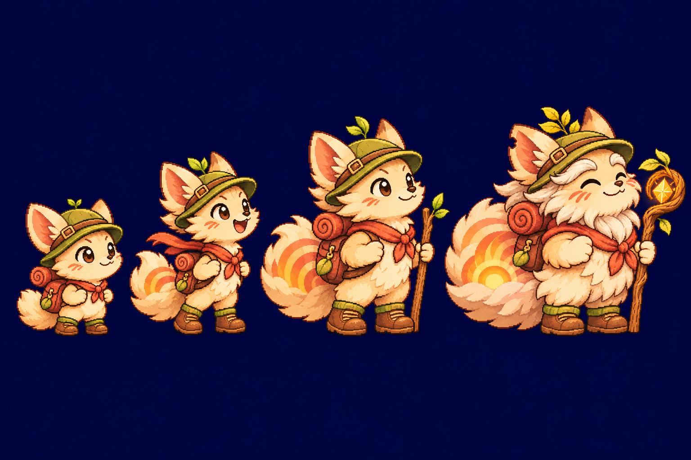
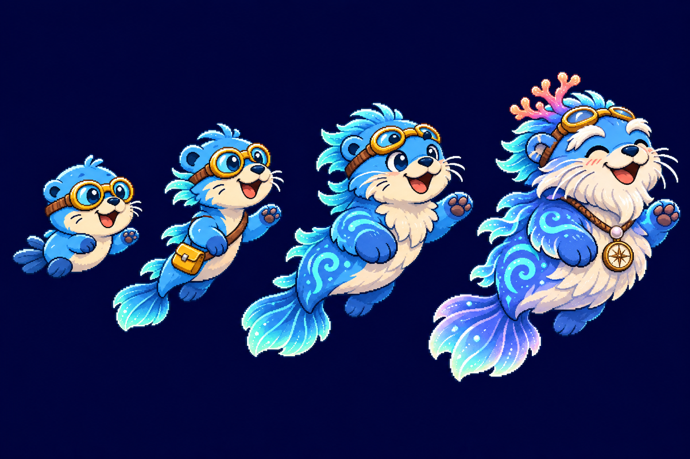
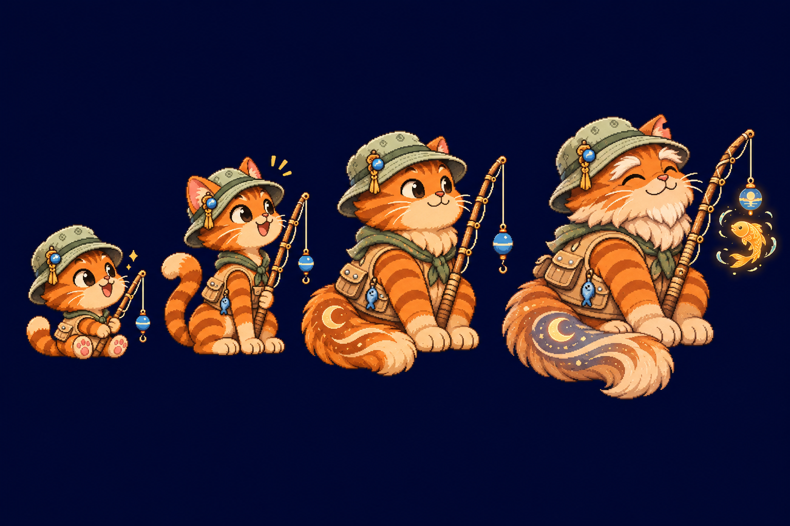
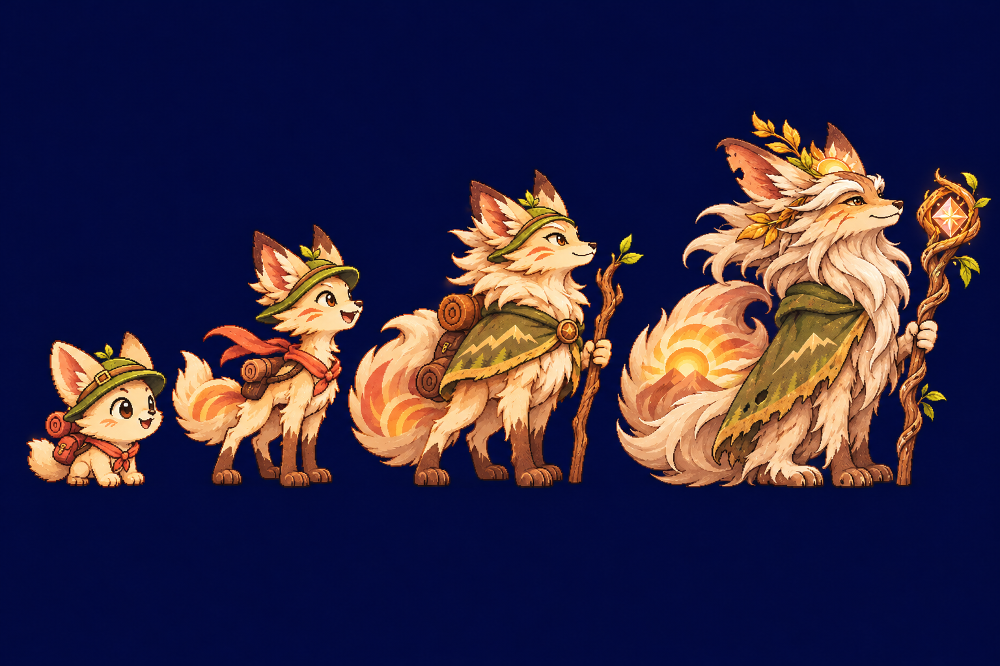
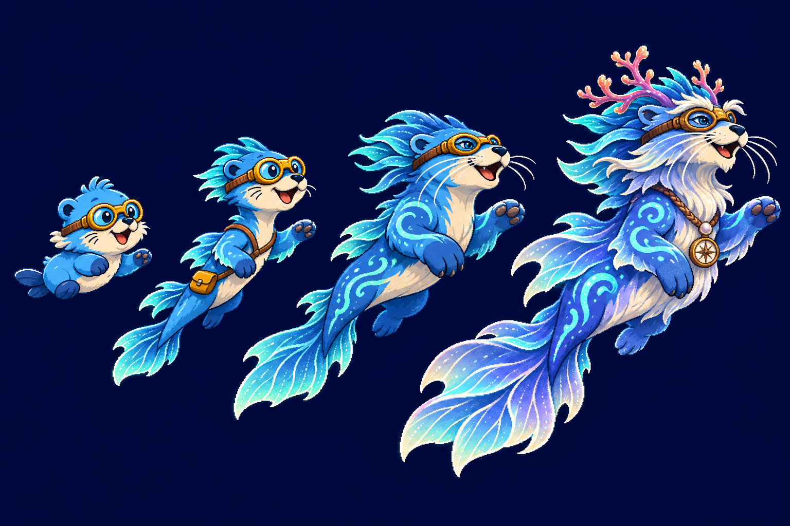
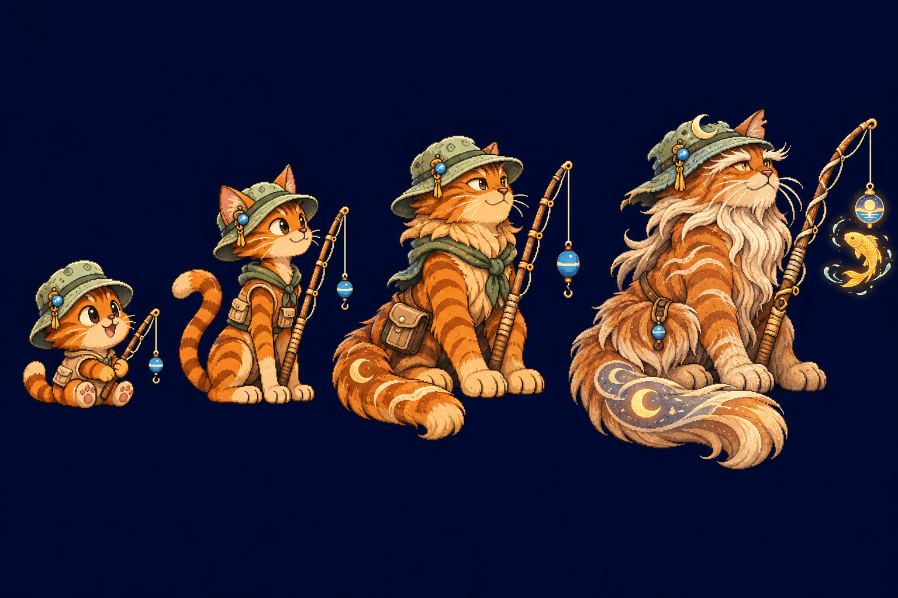
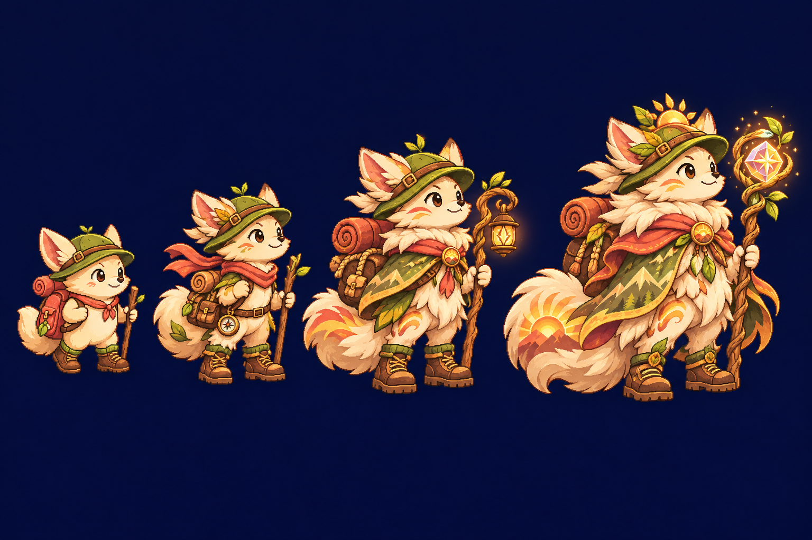
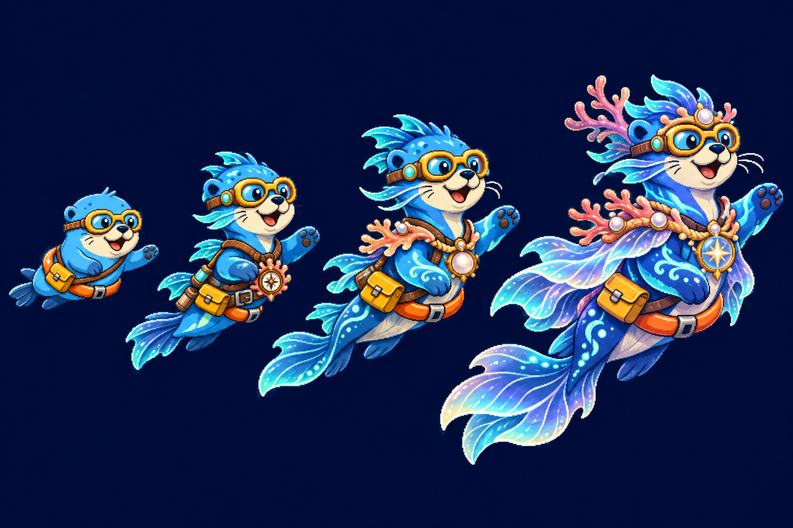
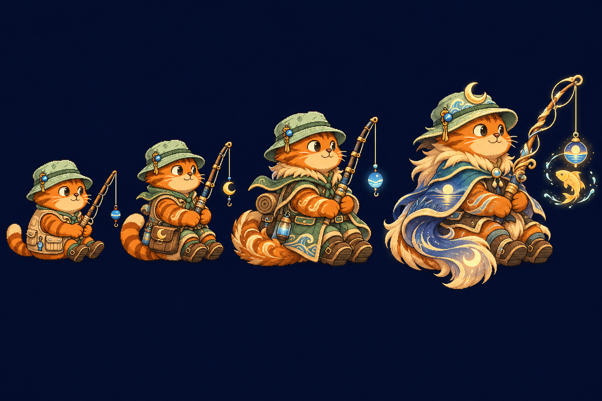

# Focus Quest 캐릭터 깜짝 진화 초안

작성일: 2026-11-17
상태: 시각·제품 콘셉트 검토용. 실제 스프라이트와 서버 판정 구현 전 단계.

## 핵심 방향

- 월드는 선택한 캐릭터로 완료한 집중 세트 `100회`까지 5단계로 성장한다.
- 캐릭터 성장은 월드 단계와 분리해, 선택한 동료와 함께 완료한 누적 집중 시간을 사용하는 비공개 장기 성장이다.
- 사용자는 진화 게이지, 남은 횟수, 정확한 조건을 볼 수 없다.
- 진화는 조건을 달성한 뒤 집중 세트를 완료하는 순간 갑자기 발생한다.
- 무작위처럼 느껴지되 실제 판정은 운이 아닌 서버의 일관된 규칙으로 처리한다.
- 타이머를 시작할 때 선택한 캐릭터에게만 완료한 집중 시간을 누적한다. 5분 Recovery Quest는 포함하고 휴식·일시정지는 제외한다.

## v3 — 귀여운 생애 진화안

v3는 v2의 생애 변화는 유지하면서, 모든 단계가 Focus Quest의 동료답게 둥글고 친근하게 보이도록 다시 조정했다. 최종형도 위압적인 전설 동물이 아니라 오랫동안 함께 공부한 포근하고 지혜로운 친구로 표현한다.

### 모리 v3

작은 여우 아이의 큰 귀와 반짝이는 눈에서 시작해, 장난기 많은 청소년과 듬직한 성체를 거쳐 흰 눈썹과 볼털을 가진 웃는 산길 수호자로 성장한다.

### 나루 v3

콩알처럼 둥근 수달 아이에서 시작해 꼬리와 물결 무늬가 발달한다. 최종형도 몸은 포근하고 둥글며, 흰 수염과 웃는 눈으로 나이를 보여준다.

### 보리 v3

통통한 고양이 아이에서 활발한 청소년, 차분한 성체를 거쳐 짧은 흰 턱수염과 웃는 눈을 가진 다정한 낚시 어른으로 성장한다.

### v3 공통 디자인 규칙

- 생애와 체형의 변화는 유지하되 모든 단계에 짧은 주둥이, 둥근 발과 풍부한 표정을 사용한다.
- 최종형도 무섭거나 근엄하지 않고 함께 쉬고 싶은 포근한 인상을 준다.
- 나이는 흰 눈썹과 볼털, 따뜻한 눈매, 여유 있는 자세로 보여주며 지나치게 노쇠하게 표현하지 않는다.
- 귀여움은 장식의 양이 아니라 얼굴 비율, 자세와 표정에서 만든다.
- 실제 게임에서는 성장할수록 대기 동작도 조급함에서 여유로움으로 바꾼다.

---

## v2 — 생애와 생물학적 변화 강화안

v2는 장비와 장식보다 캐릭터 자체의 나이와 생김새가 먼저 달라지도록 수정했다. 네 형태는 `유아기 · 청소년기 · 성체 · 노년 수호자`에 대응하며, 얼굴과 눈의 비율, 주둥이, 다리와 몸통, 귀, 꼬리, 털의 양과 자세가 단계마다 달라진다.

### 모리 v2

여우 새끼의 짧은 다리와 큰 눈에서 시작해, 날렵한 청소년기와 단단한 성체를 거쳐 긴 흰 갈기와 깊은 눈을 지닌 노년 산수호자로 변한다.

### 나루 v2

둥근 수달 새끼에서 시작해 몸통과 꼬리가 길어지고, 성체부터 물살 무늬와 지느러미 털이 몸 자체의 특징으로 자란다. 최종형은 긴 흰 수염과 거대한 물갈퀴 꼬리를 지닌 노년 바다수호자다.

### 보리 v2

작은 고양이 새끼에서 날렵한 청소년, 체격과 볼털이 두꺼워진 성체를 거쳐 흰 턱수염, 닳은 귀와 달빛 무늬 꼬리를 지닌 노년 호수지기로 성장한다.

### v2 공통 디자인 규칙

- 장비를 가려도 어느 단계인지 실루엣만으로 구분되어야 한다.
- 유아기에서 성체로 갈수록 눈의 상대 크기는 작아지고 주둥이와 사지가 길어진다.
- 최종형은 단순히 거대하거나 화려한 형태가 아니라 오래 함께했다는 세월이 얼굴과 자세에 보여야 한다.
- 모자, 고글, 낚싯대 같은 원래의 상징물은 정체성을 잇는 최소한의 장치로만 사용한다.
- 실제 스프라이트 제작에서는 단계별 높이와 충돌 영역이 달라지므로 장면 카메라와 캐릭터 기준 좌표를 함께 조정한다.

---

## v1 — 장비 중심 최초 초안

### 모리 — 산길의 수호자 계보

작은 산행 초보에서 길잡이, 고산 탐험가, 해오름 수호자로 성장한다. 크림색 털, 큰 귀, 초록 모자와 산행 정체성은 유지하고 체격, 꼬리, 털 무늬와 존재감이 함께 진화한다.

### 나루 — 유리산호 수호자 계보

장난기 많은 초보 수영가에서 산호 정찰가, 심해 길잡이, 유리산호 수호자로 성장한다. 파란 털, 금빛 고글과 밝은 표정은 유지하고 몸의 유선형, 지느러미 털, 발광 무늬와 꼬리가 발전한다.

### 보리 — 달비늘 수호자 계보

작은 낚시꾼에서 호숫가 조사자, 호수지기, 달비늘 수호자로 성장한다. 주황 줄무늬, 낚시 모자와 차분한 성격은 유지하고 체격, 물결 무늬, 꼬리와 낚시 도구가 함께 진화한다.

## 진화 판정 원칙

- 단순 완료 횟수가 아니라 선택한 동료와 실제로 완료한 집중 시간 총량으로 판정한다.
- 정확한 시간 기준은 클라이언트 코드나 공개 문서에 두지 않는다.
- 실제 서비스에서는 서버 측 비공개 설정과 판정 함수로 관리한다.
- 진화 자격을 만족하면 다음 유효 집중 완료 시 진화 이벤트를 예약한다.
- 계정과 기기가 달라도 같은 캐릭터 진화 상태가 유지되어야 한다.

## 진화 연출

1. 집중 완료 뒤 평소와 다른 짧은 정적과 환경 반응이 생긴다.
2. 캐릭터 주변에 테마별 빛과 입자가 모인다.
3. 실루엣이 단계적으로 바뀌고 새로운 형태가 나타난다.
4. 새 형태가 전용 행동을 한 번 보여준다.
5. 이름 대신 새로운 칭호와 행동이 해금되었다는 사실만 알려준다.

진화 전에 남은 횟수를 알려주지 않는다. 대신 모자가 빛나거나, 캐릭터가 새로운 도구를 살펴보거나, 잠깐 특별한 꿈을 꾸는 식의 희미한 전조만 제공한다.

## 최종 진화 이후

최종 형태를 얻은 뒤에도 성장이 끝났다고 느끼지 않도록 캐릭터별 숙련 기록은 계속 누적한다. 이후 보상은 새로운 종 전체를 계속 제작하는 방식보다 다음 요소를 비정기적으로 해금한다.

- 희귀 대기 동작과 성공 동작
- 캠프에서만 보이는 표정과 상호작용
- 계절별 모자·망토·도구 외형
- 캐릭터 주변의 절제된 빛과 발자국 효과
- 장기 집중 기록을 새긴 칭호와 기념 배지
- 매우 드문 색상·무늬 변형

이 구조는 월드가 100회에 완성된 뒤에도 캐릭터와의 유대와 수집 목표가 계속 남도록 한다.

## 구현 범위 분리

- 현재 이미지는 형태와 성장 폭을 확인하는 콘셉트 보드다.
- 확정 후 각 형태를 `대기 · 이동 · 집중 행동 · 성공 · 휴식` 스프라이트로 나눈다.
- 공통 동작 뼈대는 재사용하되 형태별 실루엣과 전용 성공 행동은 별도로 제작한다.
- 진화 조건과 서버 저장 구조는 시각안 승인 후 별도의 기능 설계로 확정한다.
