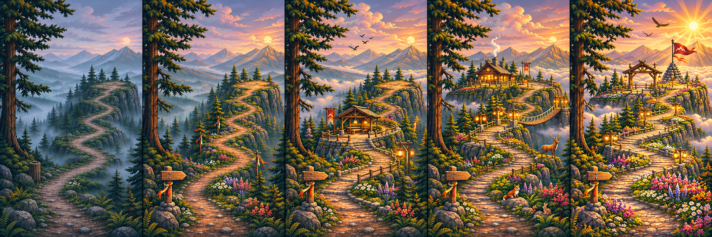
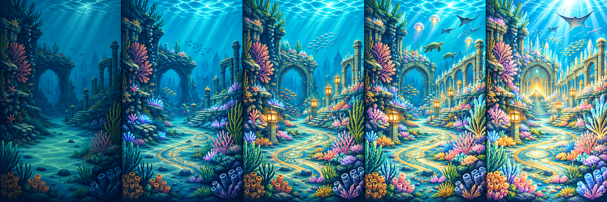
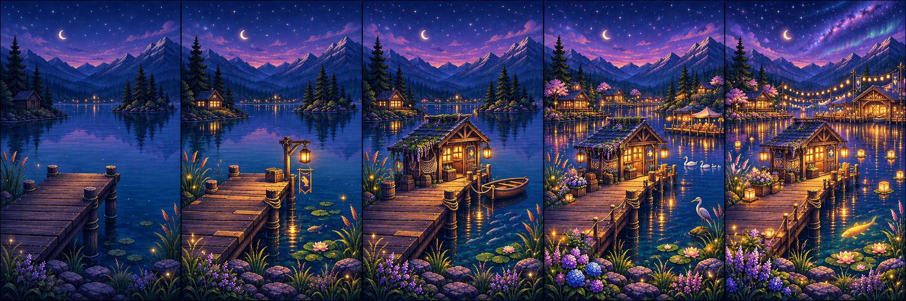
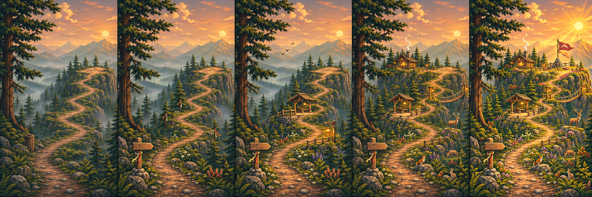
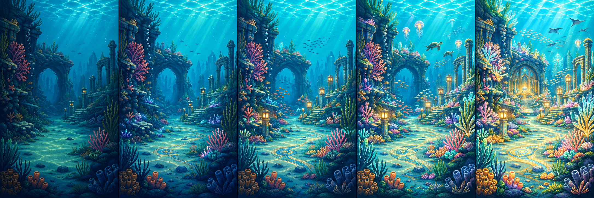
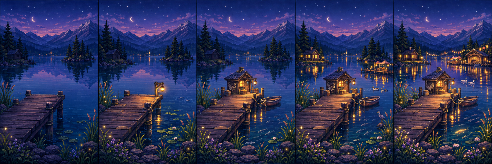

# Focus Quest 월드 성장 5단계 시각 초안

작성일: 2026-11-16
마지막 업데이트: 2026-11-17
상태: v2 방향 승인 및 3개 월드 5단계 Phaser 연결 완료.

선택한 동료의 월드만 성장한다. 10분 이상 완료한 집중 세트를 기준으로 `0~9 · 10~24 · 25~49 · 50~99 · 100회 이상`을 1~5단계로 나눈다. 여러 세트 원정은 완료한 집중 세트마다 1회로 계산하고, 5분 Recovery Quest는 월드 성장 횟수에서 제외한다. 기존 완료 기록도 같은 규칙으로 소급 계산한다.

## v2 — 단계 차이 강화안 (2026-11-17)

v2는 소품 몇 개를 더하는 방식에서 벗어나, 매 단계마다 `빛의 범위 · 생태 밀도 · 길과 거점 · 대표 랜드마크`를 함께 성장시킨다. 3단계는 세계가 본격적으로 작동하기 시작하는 전환점, 4단계는 큰 거점이 생기는 확장점, 5단계는 한눈에 감탄이 나오는 시네마틱 완성점으로 설계한다.

### 모리 — 해오름 봉우리 v2

- 1단계: 차가운 안개와 잠든 흙길로 시작한다.
- 2단계: 햇빛, 이정표, 야생화가 길의 목적을 선명하게 만든다.
- 3단계: 석재 길과 능선 쉼터가 생겨 첫 번째 큰 변화가 보인다.
- 4단계: 불 켜진 산장과 구름다리, 야생동물이 산을 살아 있는 거점으로 바꾼다.
- 5단계: 꽃이 만개한 정상 성소, 깃발, 운해와 장대한 일출로 최종 보상을 완성한다.

### 나루 — 유리산호 유적 v2

- 1단계: 어둡고 잠든 폐허와 희미한 수면광만 남아 있다.
- 2단계: 황금 모자이크 길과 첫 발광 산호가 이동 방향을 깨운다.
- 3단계: 등불, 복원된 아치, 물고기 떼가 유적을 다시 작동시킨다.
- 4단계: 거대한 회랑과 해파리·거북·가오리가 바다 정원을 이룬다.
- 5단계: 수정 산호 성소와 거대한 빛기둥, 황금빛 문이 유적 전체를 장관으로 바꾼다.

### 보리 — 달비늘 호수 v2

- 1단계: 비어 있는 낡은 부두와 고요한 남빛 호수로 시작한다.
- 2단계: 수리된 부두, 첫 등불과 연꽃이 작은 온기를 만든다.
- 3단계: 미끼 오두막, 나룻배, 물고기 떼가 첫 생활 거점을 만든다.
- 4단계: 호숫마을과 수상 시장, 물새와 겹겹의 불빛 반사가 풍경을 확장한다.
- 5단계: 별빛과 은하수 아래 등불 항구가 완성되고, 물속 황금 잉어가 최종 보상을 보여준다.

### v2 공통 성장 규칙

- 전 단계의 좋은 요소는 유지하고 다음 단계가 누적된다.
- 단계가 오를수록 색온도, 명암 범위, 원근감과 움직이는 생태가 함께 풍부해진다.
- 3단계부터는 작은 장식이 아니라 사용 가능한 거점이 등장한다.
- 4단계에는 화면의 중심을 바꾸는 대형 구조물이나 생활권이 생긴다.
- 5단계는 테마별 최종 랜드마크와 시네마틱 조명으로 명확한 완주 보상을 만든다.
- 최종 구현에서는 캐릭터와 이동 경로를 가리지 않도록 배경·중경·전경 레이어를 분리한다.

---

## v1 — 최초 방향 초안(보관)

## 모리 — 해오름 봉우리

| 단계 | 이름 | 완주 | 화면에서 달라지는 것 |
| --- | --- | ---: | --- |
| 1 | 숲길의 첫 숨 | 0~9회 | 안개가 걷히고 정상까지 이어지는 기본 길이 드러난다. |
| 2 | 길잡이의 표식 | 10~24회 | 나무 이정표, 리본, 야생화가 추가돼 길의 방향이 명확해진다. |
| 3 | 능선 쉼터 | 25~49회 | 작은 쉼터와 등불, 새와 다람쥐가 돌아온다. |
| 4 | 산장과 구름다리 | 50~99회 | 불 켜진 산장, 구름다리, 사슴이 등장해 산이 생활 공간으로 변한다. |
| 5 | 해오름 정상 | 100회 이상 | 정상 깃발과 밝은 일출, 풍성한 초목으로 완전한 목적지를 만든다. |

완주 연출은 기존 정상 도달 뒤 모리가 깃발을 꽂고, 새로 열린 정상 풍경이 짧게 밝아지는 흐름으로 연결한다.

## 나루 — 유리산호 유적

| 단계 | 이름 | 완주 | 화면에서 달라지는 것 |
| --- | --- | ---: | --- |
| 1 | 잠든 유적 | 0~9회 | 중앙 수로와 무너진 아치가 모습을 드러내고 약한 빛줄기가 들어온다. |
| 2 | 산호빛 길 | 10~24회 | 발광 산호와 바닥 모자이크가 자라 이동 경로를 안내한다. |
| 3 | 유적의 등불 | 25~49회 | 고대 등불이 켜지고 작은 물고기 떼가 돌아온다. |
| 4 | 바다의 정원 | 50~99회 | 아치와 기둥이 부분 복원되고 해파리·바다거북이 유적을 채운다. |
| 5 | 유리산호 성소 | 100회 이상 | 유리산호와 황금빛 성소가 열리며 유적 전체가 살아난다. |

완주 연출은 나루가 성소 앞 보물상자에 도착하고, 상자가 열리는 빛이 주변 산호와 등불로 퍼지는 흐름으로 연결한다.

## 보리 — 달비늘 호수

| 단계 | 이름 | 완주 | 화면에서 달라지는 것 |
| --- | --- | ---: | --- |
| 1 | 고요한 달빛 | 0~9회 | 잠든 부두와 달빛 반사, 적은 반딧불만 남아 있다. |
| 2 | 첫 등불 | 10~24회 | 부두가 수리되고 등불 하나, 연잎과 작은 물결이 추가된다. |
| 3 | 낚시꾼의 부두 | 25~49회 | 미끼 오두막, 나룻배와 물고기 그림자가 등장한다. |
| 4 | 돌아온 호숫마을 | 50~99회 | 호숫가 집과 작은 야시장 부두, 물새와 따뜻한 불빛이 돌아온다. |
| 5 | 황금빛 호수 | 100회 이상 | 항구 등불과 풍성한 반사, 물속 황금 잉어가 호수의 완성을 알린다. |

완주 연출은 보리가 마지막 캐스팅에서 황금 잉어를 끌어올리고, 호수의 등불이 차례로 켜지는 흐름으로 연결한다.

## 실제 구현 원칙

- 단계마다 같은 구도와 이동 좌표를 유지한 전용 전체 배경을 교체하고, Phaser의 기포·나뭇잎·물결·생태 움직임을 위에 합성한다.
- `원경 조명 → 길·거점 → 생태 → 최종 목적지` 순서로 해금해 성장 이유를 읽을 수 있게 한다.
- 캐릭터 이동 경로, 낚싯줄, 보물상자, 정상 깃발과 겹치는 위치에는 장식물을 두지 않는다.
- 데스크톱과 모바일의 실제 배경 표시 영역을 기준으로 오브젝트를 배치한다.
- 새 단계는 완료 화면에서 한 번 강조하고, 이후 집중 장면에는 자연스럽게 유지한다.
- 최종 에셋은 `public/backgrounds/world-stages`에 보관하며 1단계는 기존 원본 배경을 사용한다.

## 캐릭터 성장과의 분리

- 캐릭터 성장은 월드 횟수와 별도로, 선택한 동료와 함께 완료한 **누적 집중 시간**을 기준으로 한다.
- 변화는 내부에서 확정한 장기 시간 구간을 사용하며, 정확한 기준은 사용자 화면과 공개 문서에 노출하지 않는다. 5분 Recovery Quest도 누적 시간에는 포함한다.
- 일시정지와 휴식 시간은 제외한다. 진화 조건은 화면에 미리 공개하지 않는다.
- 현재 단계에서는 규칙만 확정했다. 장기 누적을 안전하게 보존할 서버 집계 구조와 진화 에셋이 준비되기 전에는 구현 완료로 안내하지 않는다.
